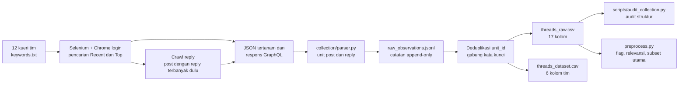

# Panduan pengumpulan data Threads

Dokumen ini menjelaskan cara kerja kolektor, cara menjalankannya dari awal sampai selesai, dan cara membaca keluarannya. Kolektor tidak memakai Threads API resmi, karena API tersebut tidak menyediakan pencarian kata kunci historis atas unggahan akun lain. Kolektor memakai Selenium dengan profil Chrome yang sudah login. Ia memuat halaman pencarian dan halaman post Threads yang dirender secara dinamis, lalu menangkap respons GraphQL Threads dari *performance log* Chrome.



## 1. Persiapan (sekali saja)

Kebutuhan: Windows/macOS/Linux, Python 3.10+, dan Google Chrome. Selenium mengunduh chromedriver sendiri.

```powershell
python -m venv .venv
.venv\Scripts\python -m pip install -r requirements.txt
```

File privat yang **tidak** ada di repo:

| File | Fungsi | Cara memperoleh |
|---|---|---|
| `config_local.py` | Salt rahasia untuk `author_hash` | Run pertama: `--new-salt`. Untuk melanjutkan dataset tim, salin dari pemilik repo dan jangan buat salt baru. |
| `profiles/<nama>/` | Sesi Chrome yang sudah login | Dibuat otomatis; login dilakukan manual oleh manusia di jendela Chrome. |
| `state/`, `output/`, `logs/` | Checkpoint dan hasil run sebelumnya | Hanya diperlukan untuk `--resume`. |

## 2. Menjalankan

Run baru (orang pertama saja, karena salt baru membuat `author_hash` tidak bisa digabung dengan data lama):

```powershell
.venv\Scripts\python scraper.py --new-salt --profile account_a --keywords keywords.txt
```

Melanjutkan run yang sudah ada (perintah produksi tim):

```powershell
.venv\Scripts\python scraper.py --profile account_a --keywords keywords.txt --resume
```

Saat pertama kali dijalankan, Chrome terbuka dan terminal meminta login. Login manual ke Threads di jendela tersebut, lalu tekan Enter. Kata sandi tidak pernah diketik atau disimpan oleh kode. Periksa baris log `salt fingerprint ...`; untuk dataset tim nilainya harus `6888537f`.

Opsi lain: `--only "MBG 2027"` (satu kueri), `--max-pages N` (uji coba), `--phase search|replies`, `--data-dir runs/uji` (pisahkan hasil uji), dan `--merge a.jsonl b.jsonl --data-dir runs/merged` (gabungkan run dari beberapa mesin).

### Kode keluar

| Kode | Arti | Tindakan |
|---|---|---|
| 0 | Log berisi `DONE`; semua pencarian dan crawl reply selesai. | Ambil berkas di `output/`. |
| 2 | Berhenti karena halaman login/challenge, HTTP 429, teks "try again later", atau 4 scroll kosong berturut-turut (*soft block*). Checkpoint tersimpan. | Tunggu beberapa **jam**, lalu jalankan perintah yang sama dengan `--resume`. Jangan diulang dalam loop dan jangan mengurangi jeda. |
| 130 | Dihentikan dengan Ctrl+C. Checkpoint tersimpan. | Jalankan lagi dengan `--resume`. |

## 3. Apa yang dilakukan kolektor

1. **Kueri.** `keywords.txt` berisi 12 kueri tim. Baris `kueri tim | kueri fetch` berarti pencarian Recent memakai bentuk dua kata, karena Threads meng-OR-kan kueri tiga kata atau lebih. Totalnya 8 pencarian Recent yang berbeda dan 12 pencarian Top, yaitu **20 pekerjaan pencarian**.
2. **Pencocokan.** Hasil pencarian hanya disimpan bila teksnya memuat *setiap* kata dari minimal satu kueri tim (substring tanpa membedakan huruf besar/kecil). Kueri yang cocok dicatat di `matched_keywords`. Aturan ini adalah filter koleksi, bukan penilaian relevansi akhir.
3. **Jendela waktu.** Hanya unit yang terbit dalam `[2026-09-02 17:00 UTC, 2026-09-30 17:00 UTC)`, yaitu 3–30 September 2026 WIB, yang disimpan.
4. **Paginasi.** Halaman di-scroll; tiap scroll memicu `BarcelonaSearchResultsRefetchableQuery` dengan *cursor* berikutnya, sampai `has_next_page` habis. Recent berurutan dari yang terbaru, berhenti setelah 2 halaman berturut-turut sebelum 3 September atau pada batas 1.500 halaman. Setelah 50 halaman, kolektor memperkirakan apakah 3 September masih bisa dicapai di bawah batas itu. Top berurutan menurut relevansi dan dibatasi 50 halaman per kueri.
5. **Reply.** Setelah pencarian, kolektor mengunjungi post dalam jendela yang punya minimal satu reply, dimulai dari yang reply-nya terbanyak. Ia mengambil `BarcelonaPostPageDirectRepliesRefetchQuery` sampai 15 scroll per post. Reply bertingkat yang tersembunyi di balik tombol tambahan bisa terlewat.
6. **Etika teknis.** Ada jeda acak 3–7 detik antaraksi. Kolektor tidak pernah melewati challenge atau CAPTCHA. Username tidak disimpan di kolom terstruktur; penulis disimpan sebagai `author_hash` = SHA-256(salt + username).

Parameter persisnya ada di [collection/config.py](../collection/config.py). Detail bentuk respons GraphQL ada di [catatan rekonaisans](history/threads_recon_2026-10-26.md).

## 4. Keluaran dan cara membacanya

| Berkas | Isi | Catatan |
|---|---|---|
| `output/raw_observations.jsonl` | Setiap pengamatan hasil parse, append-only | Satu unit bisa muncul berkali-kali (beberapa kueri atau resume). |
| `output/threads_raw.csv` / `.jsonl` | Satu baris per `unit_id`, 17 kolom | Input untuk preprocessing. `text` tidak diubah. |
| `output/threads_dataset.csv` | Proyeksi 6 kolom untuk tim: `content_id, platform, text, created_at, content_type, permalink` | Belum difilter relevansi atau dibersihkan. |
| `state/checkpoint.json` | Pekerjaan pencarian yang selesai (`search_done`) dan post yang reply-nya sudah di-crawl (`replies_done`) | Dipakai `--resume`. |
| `logs/scrape_*.log` | Progres, jumlah unit, alasan berhenti | Simpan untuk bukti kelengkapan run. |

CSV dibangun ulang setelah setiap pencarian selesai dan setiap 10 post saat crawl reply. Saat ekspor, pengamatan digabung per `unit_id`, `matched_keywords` disatukan, dan jumlah like/reply diambil dari pengamatan terakhir. Arti setiap kolom ada di [kamus data](data_dictionary.md).

Contoh membaca hasil dengan pandas (ID harus dibaca sebagai string):

```python
import pandas as pd
df = pd.read_csv("output/threads_raw.csv", dtype=str)
print(df.unit_type.value_counts(), df.search_mode.value_counts())
```

## 5. Setelah koleksi

1. Audit struktur (read-only), untuk memeriksa ID unik, jendela waktu, dan konsistensi ekspor 6 kolom:
   `python scripts/audit_collection.py --raw output/threads_raw.csv --team output/threads_dataset.csv --checkpoint state/checkpoint.json --output metadata/collection_snapshot_<tanggal>.json`
2. Bekukan ekspor ke `data/raw/threads_units_2026-09_v1.csv`, lalu catat hash-nya di `metadata/`.
3. Preprocessing: `python preprocess.py` (lihat [protokol](preprocessing_protocol.md)).
4. Tes: `python -m unittest discover -s tests` (tes yang butuh data privat otomatis di-skip).

## 6. Hasil run tim dan batasannya

Snapshot beku 27 Oktober 2026 berisi 9.368 unit unik: 2.196 post, 6.835 reply, dan 337 self-thread. Menurut penemuan pertama, 5.232 unit berasal dari Recent, 73 dari Top, dan 4.063 dari crawl reply. Ringkasannya ada di [metadata/collection_snapshot_2026-10-27.json](../metadata/collection_snapshot_2026-10-27.json). Checkpoint dan log final tidak ada di repo, jadi kelengkapan ke-20 pencarian tidak dapat dibuktikan dari checkout ini. Run ulang bisa memberi hasil berbeda karena ranking pencarian, post yang dihapus, rate limit, atau perubahan antarmuka Threads. Lihat [kualitas data](data_quality.md), [reproduksibilitas](reproducibility.md), dan [etika](ethics_and_limitations.md).
